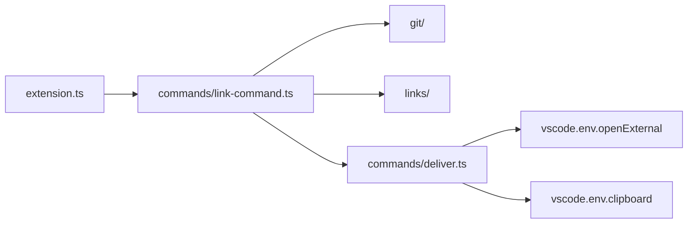

# How the extension is built

The extension turns the open file into a web link with git, then opens it in the browser or copies it.

## Modules

| Folder             | Job                                                                                                                  |
| ------------------ | -------------------------------------------------------------------------------------------------------------------- |
| `src/extension.ts` | Registers the 8 commands from `package.json`.                                                                        |
| `src/commands/`    | Reads the settings and the selection, builds the link, then opens or copies it. The only code that imports `vscode`. |
| `src/git/`         | Runs git with `execFile`, finds the repo root, reads the remote URL and picks the branch.                            |
| `src/links/`       | Turns a remote into a web URL and writes the file, blame and history link for each host.                             |
| `src/test-host/`   | Starts the tests inside a VS Code window.                                                                            |

## Data

The extension keeps no state. Each command reads these, then forgets them:

- **Settings** the `openInGitHub.*` keys in `package.json`, read for the file's folder.
- **Git** `git rev-parse`, `git config --get remote.<name>.url`, `git ls-remote --get-url` for an alias, `git symbolic-ref` and `git rev-parse --verify` in the file's repo. git stops after 10 seconds.

## Outside services

- **Browser** `vscode.env.openExternal` opens the default browser on the person's machine, in local and remote windows.
- **Hosts** the link points at GitHub, GitLab, Bitbucket or Bitbucket Server. The extension sends them no requests.

## The path of one command

1. **Target** the Explorer item, or the active editor and its selected lines.
2. **Repo** `findRepoRoot` runs in the file's folder. A symlink resolves to its target inside the repo.
3. **Branch** `pickBranch` takes the first branch that holds the file on the remote: the setting, the remote HEAD, `main`, `master`. Otherwise the current branch, or the commit on a detached HEAD.
4. **Link** `pickHost` reads `openInGitHub.repositoryType`, or the remote host on `auto`.
5. **Hand off** `openInBrowser` or `copyToClipboard`. A failure shows git's message.

## Decisions

### Starting point: a fork of Open in GitHub

- **Picked** the extension forks Open in GitHub by Stanislav Sysoev and
  ships as `workbench-soft.open-in-remote-repo`.
- **Why** the original already built links for 4 hosts, with tests. The fork
  needed its own name to link to `main` or `master` without the branch
  picker.
- **Trade-off** the code came with the original's tools and its old
  `engines.vscode` floor of 1.75. A new id means people uninstall the old
  extension.
- **Rejected**
  - **A new extension from scratch** it would rewrite the host links and
    their tests.
- **Cost to undo** high. A new extension starts over.

### Links: built from local git, no host API

- **Picked** the extension reads the remote URL and the branches through git
  and writes the link itself. It sends the hosts no requests.
- **Why** git already holds the remote and the branches. No token or login
  is needed for GitHub, GitLab or Bitbucket.
- **Trade-off** the link can't confirm the file exists on the host. The
  branch check reads the remote branches that git fetched last.
- **Rejected**
  - **The host REST APIs** a token per host, and a call over the network on
    each click.
- **Cost to undo** high. `src/git/` and `src/links/` change.

### Module split: `vscode` only in `src/commands/`

- **Picked** `src/commands/` is the only folder that imports `vscode`.
  `src/git/` and `src/links/` are plain TypeScript.
- **Why** the unit tests of `git/` and `links/` then run in Node through
  `mise run test`, without a VS Code window.
- **Trade-off** the editor glue in `commands/` needs the slower test window
  in `src/test-host/`.
- **Rejected**
  - **One module per command** each test would need VS Code running.
- **Cost to undo** medium. The imports across the three folders.

### Git calls: `execFile` with a timeout

- **Picked** `src/git/run-git.ts` runs git through `execFile`. git stops after
  10 seconds.
- **Why** a shell let the `openInGitHub.defaultRemote` setting run shell
  commands. Offline, a partial clone waited 23 seconds.
- **Trade-off** each git call starts a process.
- **Rejected**
  - **`exec` through a shell** the setting could run commands.
- **Cost to undo** low. One file.

### Browser: `vscode.env.openExternal`

- **Picked** links open through VS Code, and copies go through
  `vscode.env.clipboard`.
- **Why** the `open` package passed the link through PowerShell on Windows,
  so `users.$id.tsx` opened as `users..tsx`. In SSH and container windows it
  opened no browser on the person's machine.
- **Trade-off** VS Code asks before it opens a host outside its trusted
  domains, such as GitLab.
- **Rejected**
  - **The `open` package** the broken links above. Its older form `opn` with
    `xdg-open` broke in remote windows too.
- **Cost to undo** low. `src/commands/deliver.ts`.

### Bundle: one file through esbuild

- **Picked** `build.js` bundles the sources into `out/extension.js`, with
  `vscode` left external.
- **Why** the extension took long to load. One bundled file made the package
  smaller and the load faster.
- **Trade-off** the org stack names Vite for bundles, so this repo is off
  the list. esbuild 0.28 drops the `watch` option `build.js` uses.
- **Rejected**
  - **The `tsc` output as is** many files to load at start.
- **Cost to undo** low. `build.js` and the `package` script.

### Tools: npm and Mocha from the fork, oxlint and oxfmt from the org

- **Picked** the repo keeps npm with `package-lock.json` and Mocha, as the
  fork brought them. oxlint and oxfmt replaced Prettier 2.
- **Why** the org rule wants oxlint and oxfmt in every repo. No change has
  moved the package manager or the test runner yet.
- **Trade-off** the org rule names pnpm and Vitest, and `package-lock.json`
  marks the repo to move.
- **Rejected**
  - **Prettier 2** the org stack bans it, and the repo had no linter beside
    it.
  - **pnpm and Vitest now** the move waits for its own change.
- **Cost to undo** low. `package.json`, the lockfile and the test runner.

### Languages: `vscode.l10n` with 9 catalogs

- **Picked** `package.nls.<code>.json` names the commands and settings.
  `l10n.t()` and `l10n/bundle.l10n.<code>.json` translate the messages.
- **Why** the org ships each app in 9 languages, and its rule names
  `vscode.l10n` for a VS Code extension.
- **Trade-off** VS Code ships no Norwegian language pack, so `nb` shows only
  with a community pack.
- **Rejected**
  - **i18next** the org tool for TypeScript apps. VS Code already picks the
    display language for `vscode.l10n`.
- **Cost to undo** low. The catalogs and the `l10n.t()` calls.

### Releases: a `.vsix` on GitHub, Marketplace by hand

- **Picked** each green push to `main` gets a GitHub release with the
  `.vsix`, built on `ubuntu-latest`. A Marketplace publish stays manual.
- **Why** the repo is public, so a GitHub runner costs 0 minutes and fork
  PRs stay off the PC. A Marketplace publish needs a token and a person.
- **Trade-off** vsce takes semver only, so the tag `v2026.10.30.1` turns into
  `2026.1030.1`. People who install from the Marketplace wait for the manual
  publish.
- **Rejected**
  - **The Windows PC runner** a fork's PR could run its code on that PC.
  - **Publish to the Marketplace from CI** the token would sit in the repo
    secrets of a public repo.
- **Cost to undo** low. The two workflows.
