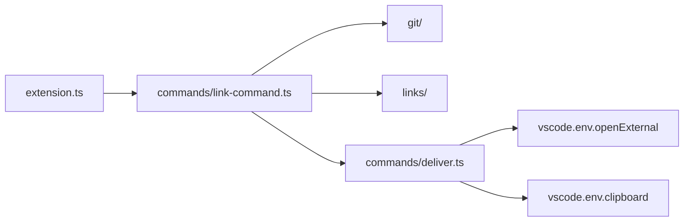
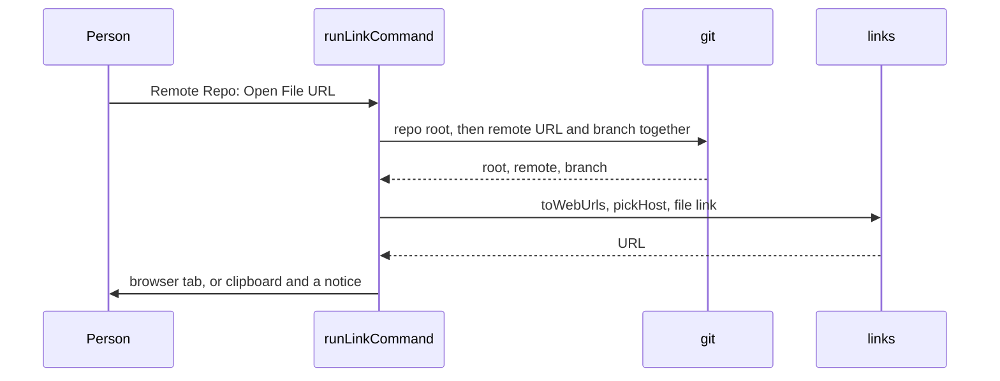

# How the extension is built

The extension turns the open file into a web link with git, then opens it in the browser or copies it.

## Modules

| Folder | Job |
| --- | --- |
| `src/extension.ts` | Registers the 8 commands from `package.json`. |
| `src/commands/` | Reads the settings and the selection, builds the link, then opens or copies it. The only code that imports `vscode`. |
| `src/git/` | Runs git with `execFile`, finds the repo root, reads the remote URL and picks the branch. |
| `src/links/` | Turns a remote into a web URL and writes the file, blame and history link for each host. |
| `src/test-host/` | Starts the tests inside a VS Code window. |

## Data

The extension keeps no state. Each command reads these, then forgets them:

- **Settings** the `openInGitHub.*` keys in `package.json`, read for the file's folder.
- **Git** `git rev-parse`, `git remote get-url <name>`, `git symbolic-ref` and `git rev-parse --verify` in the file's repo. git stops after 10 seconds.

## Outside services

- **Browser** `vscode.env.openExternal` opens the default browser on the person's machine, in local and remote windows.
- **Hosts** the link points at GitHub, GitLab, Bitbucket or Bitbucket Server. The extension sends them no requests.

## The path of one command

1. **Target** the Explorer item, or the active editor and its selected lines.
2. **Repo** `findRepoRoot` runs in the file's folder. A symlink resolves to its target inside the repo.
3. **Branch** `pickBranch` takes the first branch that holds the file on the remote: the setting, the remote HEAD, `main`, `master`. Otherwise the current branch, or the commit on a detached HEAD.
4. **Link** `pickHost` reads `openInGitHub.repositoryType`, or the remote host on `auto`.
5. **Hand off** `openInBrowser` or `copyToClipboard`. A failure shows git's message.
