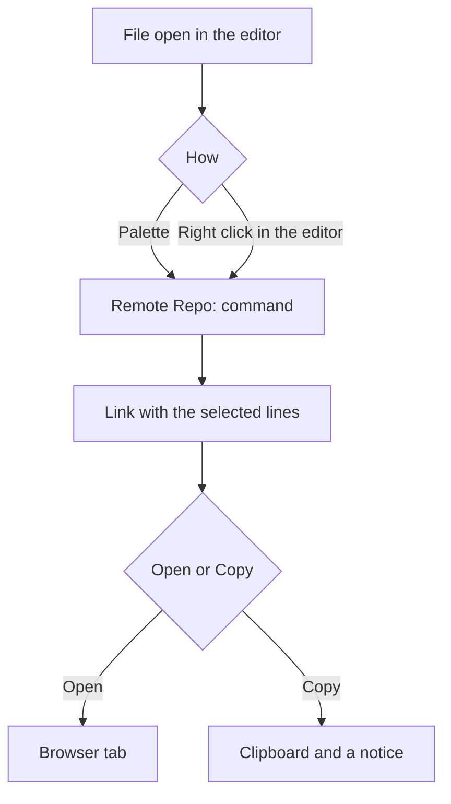
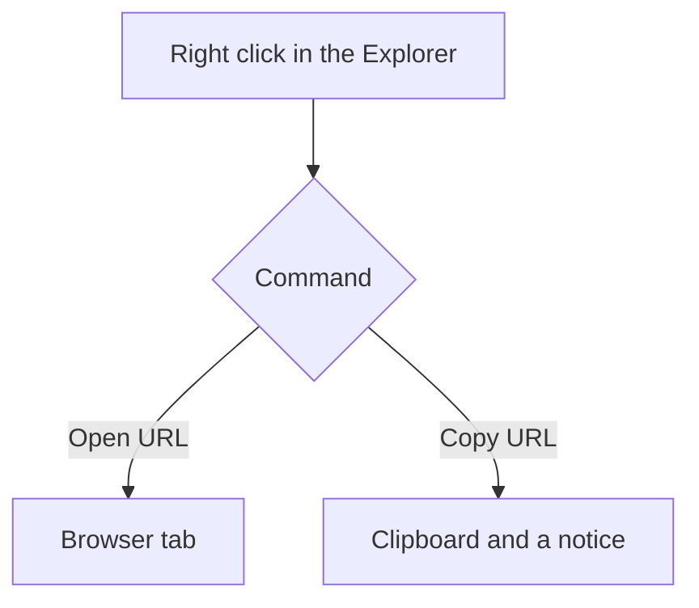
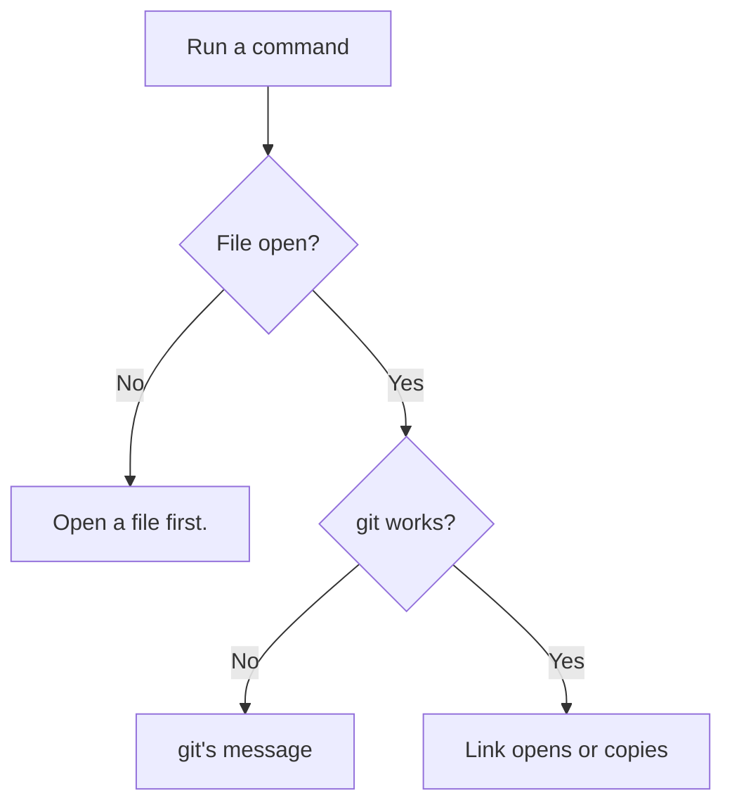

# User flows

Each flow starts in a VS Code window with a folder from a git repo.

## Open or copy a link from the editor

1. The person opens a file and selects lines, or leaves the cursor on one line.
2. The person runs a `Remote Repo:` command from the palette, or right clicks in the editor.
3. The extension builds the file, blame or history link for the selected lines.
4. An Open command opens the link in the browser. A Copy command puts it on the clipboard and shows `Copied to the clipboard: <url>`.

## Open or copy a link from the Explorer

1. The person right clicks a file or a folder in the Explorer.
2. The person picks **Remote Repo: Open URL** or **Remote Repo: Copy URL**.
3. The extension builds the file link with no line anchor.
4. The link opens in the browser, or lands on the clipboard.

## A command fails

1. The person runs a command outside a git repo, or with no remote.
2. git fails, and VS Code shows git's message in an error notice.
3. With no file open, the notice reads `Open a file first.` An unsaved file asks to be saved in a git repo first.
4. A remote with no web form, such as a local path, gets a notice that names it.

